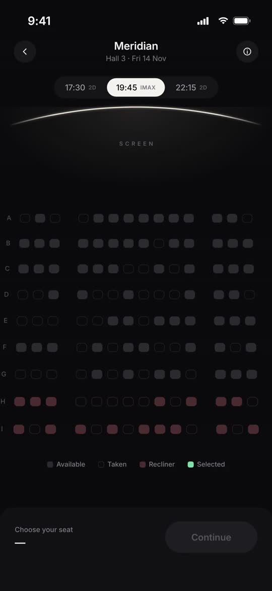
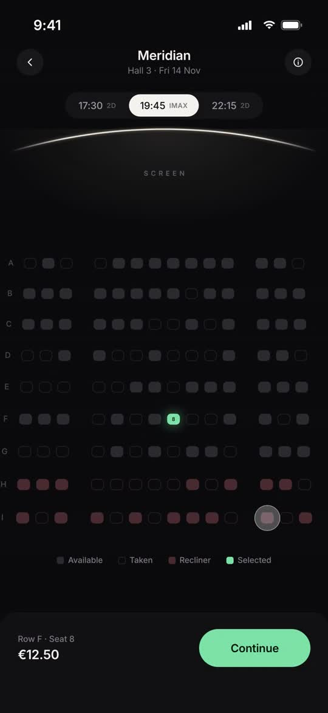
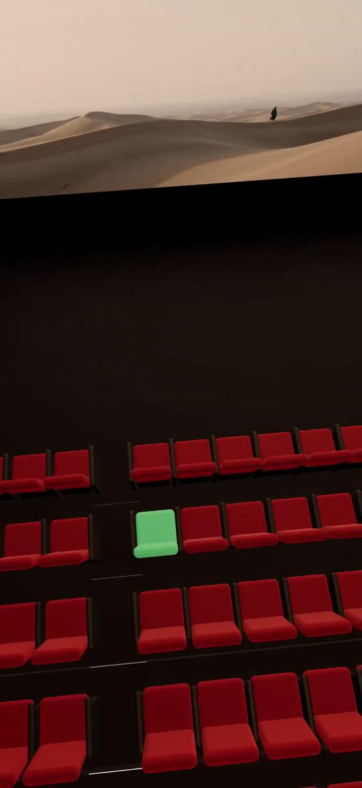
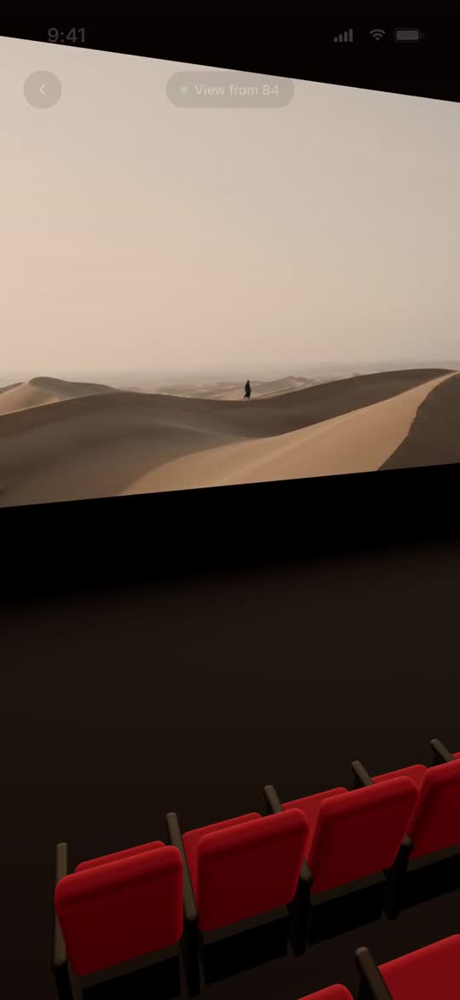
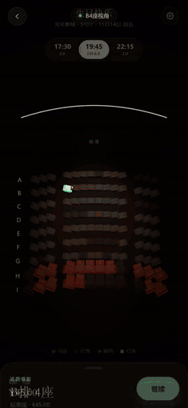
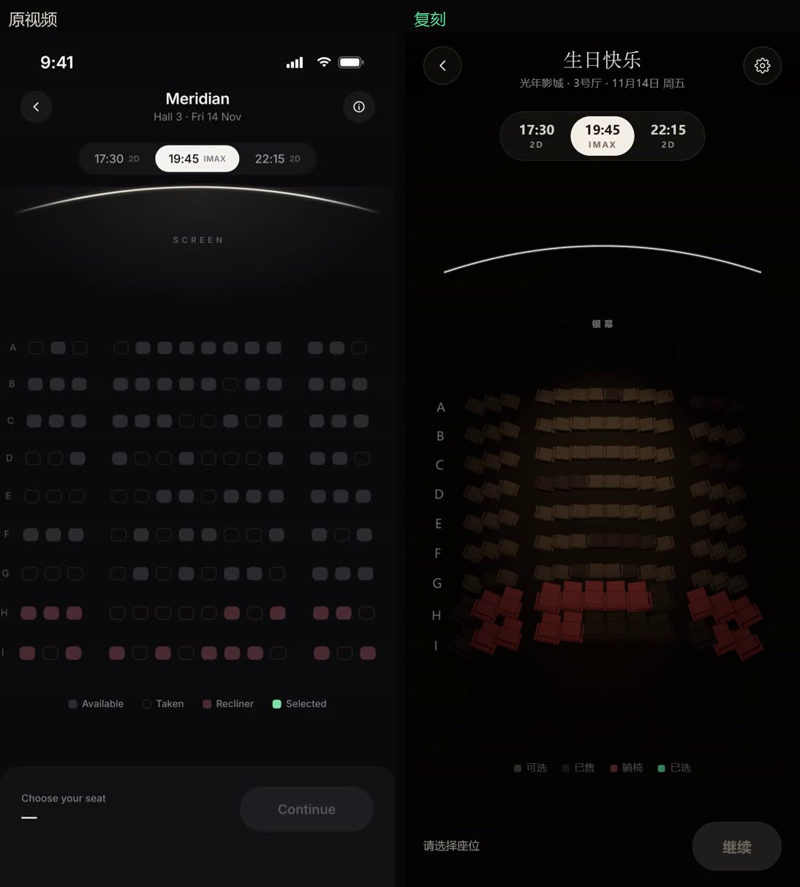
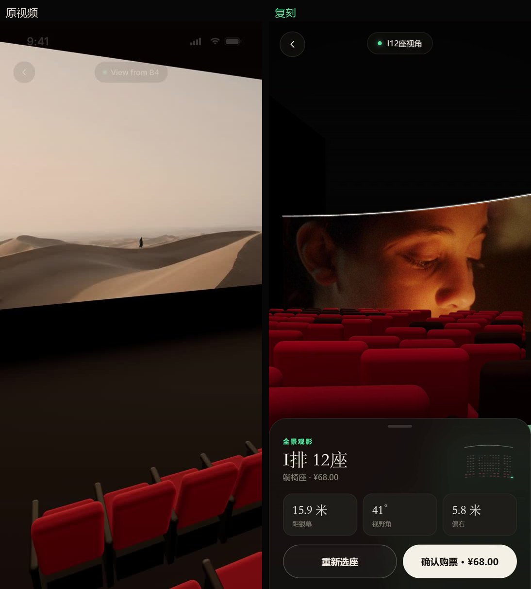

# 001 · 影厅选座 → 飞入座位视角

在座位图上点一个座位，拖起"继续"，镜头会从楼座上空俯冲进场，掠过一排排椅背，最后落在你选的那张座位的后上方——你就坐在那里看银幕。

## 原始出处

- 推文：[@yyyole](https://x.com/yyyole/status/2119438365435253159)
- 原视频展示的是一部影院 App 的选座页，页面语言为英文、货币为欧元

原推文配文大意：*"居然还能这么玩？这个创意也太棒了……所以真正优秀的产品设计，一定是把用户体验做进了交互细节里。不光电影院，很多场景都可以学习一下。"*

### 原视频关键帧

| 步骤 | 画面 |
|------|------|
| ① 俯视座位图 |  |
| ② 选中座位，底部条浮出价格 |  |
| ③ 转场中的影厅 |  |
| ④ 落座后的座位视角 |  |

## 复刻效果

飞入转场（点 Continue 到落座）：



完整录屏约 19 秒，包含选座 → 飞入 → 返回座位图 → 换场次 → 再飞入：

[▶ docs/demo.mp4](docs/demo.mp4)

### 对照

座位图：



座位视角：



## 复刻里做了什么

保留原作的骨架：俯视座位图 → 点座位 → 底部条显示行座与价格 → 点继续 → 飞入并落在所选座位后方 → 显示距离 / 视野角 / 偏离中轴的座位数据卡。

在这之上补了几处原作没有的东西：

- **银幕画面随座位实时取景**：银幕按所选座位的距离和角度决定画面占比，不是贴一张固定图
- **转场中座椅材质渐变色**：飞入的一秒里，全场座椅由灰转红，银幕画面直到镜头转向它才渐显，不会在地图上突兀地弹出来
- **换场次重掷售出情况**：三个场次各自的已售座位是独立的
- **深链接**：`?seat=B4` 预选座位，`?seat=B4&view=seat` 直接进座位视角，方便演示

## 实现要点

- 相机姿态用 **look-at 参数**（位置 / 目标 / up / fov）插值，而不是四元数 slerp。俯视图的 up 是 `-Z`、座位视角是 `+Y`，直接 slerp 会在中途翻滚，镜头会飘到空处
- 飞行路径是一条 `QuadraticBezierCurve3`，控制点抬到两端最高点之上，避免俯冲时穿过椅背
- 俯视图的取景范围用二分搜索求：把银幕弧线和首末排座位角点投影到试探相机里，迭代 26 次找到刚好能装下全部内容的最小距离
- 座位几何用 `RoundedBoxGeometry`，躺椅区比标准区座位更宽、更靠后，并在 x 方向做了弧形错位
- 静态视角下相机完全锁定，不做任何逐帧微动——高对比度的座椅边缘只要有亚像素抖动就会被看成闪烁

## 运行

```bash
cd demo
python -m http.server 8123
# 打开 http://127.0.0.1:8123
```

银幕画面取自 `demo/assets/screen-still.jpg`；文件缺失时银幕保持全黑，不会报错。
